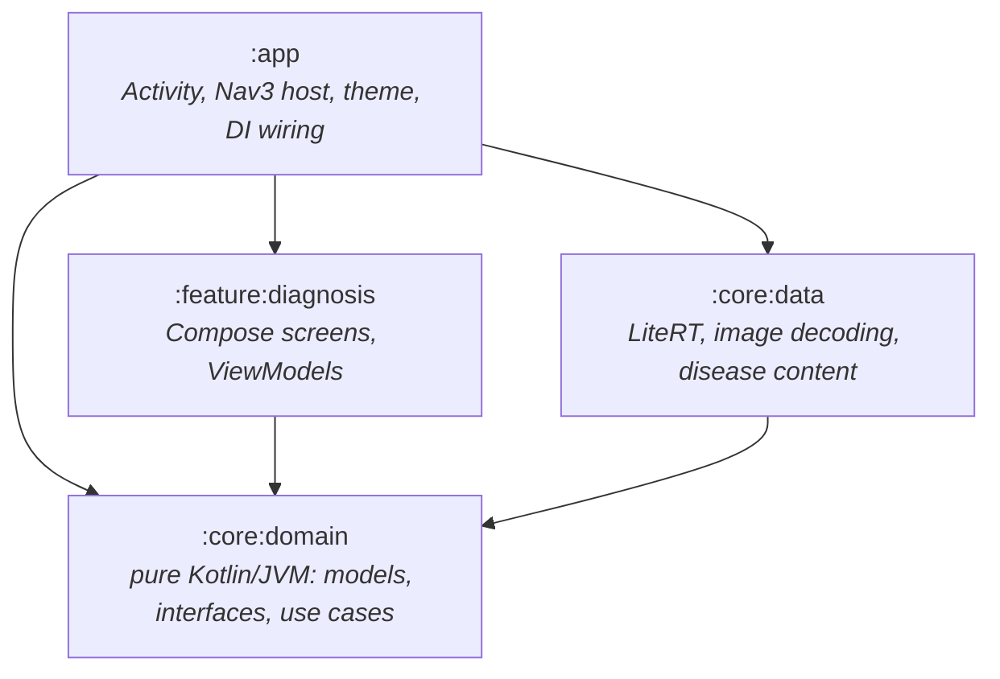

<h1 align="center">Tomato leaf disease prediction machine learning app</h1>

<p align="center">
  Pick a photo of a tomato leaf. The app tells you whether it looks healthy or which of nine diseases it most likely has. Everything runs on your phone.
</p>

<p align="center">
  
  
  
  
</p>

---

## Demo

https://user-images.githubusercontent.com/61627836/186446347-5a76f82d-5000-4fe1-96ef-8fc3d0ce913d.mp4

> The demo shows v1 (Java + XML views). v2 keeps the same flow (pick → predict → learn more) but rebuilds it in Kotlin and Compose, and adds a confidence percentage, the top‑3 results and a "not sure" state.

## Contents

- [Features](#features)
- [Tech stack](#tech-stack)
- [Architecture](#architecture)
- [Requirements](#requirements)
- [Build and test](#build-and-test)
- [Model contract](#model-contract)
- [Privacy](#privacy)
- [Disclaimer](#disclaimer)
- [Known limitations and open questions](#known-limitations-and-open-questions)
- [Device verification](#device-verification)

## Features

- **On-device classification** into 10 classes: healthy plus 9 tomato leaf diseases.
- **Confidence and ranking:** the top prediction as a percentage, plus the top 3 classes with confidence bars.
- **"Not confident" state** when the top score is below a threshold (0.60 by default).
- **Disease info:** a short summary for each disease and a link to an extension-service guide, opened in a Custom Tab.
- **System photo picker:** no storage permission is needed.

## Tech stack

| Area | Library | Version |
|---|---|---|
| Language | Kotlin (K2, built into AGP 9) | 2.4.21 |
| UI | Jetpack Compose BOM, Material 3 | 2026.11.01 (Compose 1.13, Material 3 1.5) |
| Navigation | Navigation 3 (typed keys, app-owned back stack) | 1.2.2 |
| State | Lifecycle ViewModel, `StateFlow`, kotlinx.coroutines | 2.11.1 / 1.11.0 |
| DI | Hilt + KSP | 2.60.1 / 2.3.14 |
| ML runtime | LiteRT `CompiledModel` API, CPU, bundled | 2.4.0 |
| Images | Coil (preview only) | 3.6.3 |
| Other | core-splashscreen, AndroidX Browser (Custom Tabs), kotlinx.serialization | 1.2.0 / 1.10.0 / 1.13.0 |
| Build | Android Gradle Plugin, Gradle | 9.5.3 / 9.9.2 |
| Tests | JUnit 4, kotlinx-coroutines-test, Turbine, `java-test-fixtures` fakes | 4.13.2 / 1.11.0 / 1.2.1 |
| SDK levels | compileSdk / targetSdk / minSdk | 37.2 / 37 / 24 |

## Architecture

Clean architecture with four Gradle modules. Dependencies point inwards only:



**Dependency rule**
- `:core:domain` depends on nothing. It is a plain Kotlin JVM module, so importing an Android class there is a compile error, not just a convention.
- `:core:data` and `:feature:diagnosis` depend only on `:core:domain`, never on each other.
- `:app` is the only module that sees everything. It wires implementations to interfaces.

### How the layers map to SOLID

| Principle | Where it shows up |
|---|---|
| **SRP** (single responsibility) | Each class has one job. `DiagnoseLeafUseCase` ranks predictions and applies the confidence policy. `PixelTensorConverter` turns pixels into the input tensor. `ScoreMapper` turns raw scores into `Prediction`s. `LiteRtInferenceEngine` only runs the model. `StaticDiseaseInfoRepository` only serves content. `DiagnosisViewModel` only owns screen state. |
| **OCP** (open/closed) | `ConfidencePolicy` is a `fun interface`. A different rule, such as a margin between the top two scores, is a new class. `DiagnoseLeafUseCase` does not change. Normalization lives in a single `ModelSpec`, so changing the preprocessing does not touch the classifier. |
| **LSP** (Liskov substitution) | `LiteRtLeafDiseaseClassifier` and the test `FakeLeafDiseaseClassifier` both honour the `LeafDiseaseClassifier` contract: one `Prediction` per class, `ClassificationException` for expected failures, and `CancellationException` always propagates. Either can be given to `DiagnoseLeafUseCase`, and the domain tests rely on that. |
| **ISP** (interface segregation) | Interfaces are small and specific to the client. `LeafDiseaseClassifier`, `DiseaseInfoRepository` and `ConfidencePolicy` each have one method. Inside data, `ImageTensorSource` and `InferenceEngine` split "get pixels" from "run model". The feature module sees only use cases, never LiteRT or `Bitmap` APIs. |
| **DIP** (dependency inversion) | The domain owns the abstractions. Data implements them, and Hilt binds them in `DataModule`. The use cases have no DI annotations; `:app`'s `DomainModule` builds them. High-level policy (`DiagnoseLeafUseCase`) never refers to a LiteRT type. |

### Module layout

```
core/domain/        model/, classifier/, repository/, usecase/   (+ src/testFixtures fakes)
core/data/          classifier/, inference/, image/, info/, di/  (+ assets/tomato_leaf_disease.tflite)
feature/diagnosis/  DiagnosisScreen + ViewModel, info/ DiseaseInfoScreen + ViewModel, components/
app/                MainActivity, navigation/, di/DomainModule, ui/theme/
```

Inference runs on one dedicated single-thread dispatcher (`litert-inference`), which creates, runs and closes the `CompiledModel`. Image decoding runs on `Dispatchers.IO`; resizing and tensor conversion run on `Dispatchers.Default`. The model is loaded lazily on the first analysis and kept for the life of the process.

## Requirements

- **JDK 17.** AGP 9.5 and Gradle 9.9 need it.
- **Android Studio** with AGP 9.5 support. See the [AGP and Android Studio compatibility table](https://developer.android.com/build/releases/gradle-plugin#android_gradle_plugin_and_android_studio_compatibility).
- **Android SDK platform 37.2** (`compileSdk 37`, `compileSdkMinor 2`). Compose 1.13 requires it.
- **Device or emulator on Android 7.0 (API 24) or newer.** LiteRT ABIs: arm64-v8a, armeabi-v7a, x86_64 (no 32-bit x86).

> **minSdk went from 21 to 24 in v2.** LiteRT 2.x, Compose 1.13 and Material 3 1.5 all declare minSdk 24. Devices on Android 5.0–6.0 stay on v1.

## Build and test

```bash
# Build the debug APK and run every unit test, including the pure-JVM domain module
./gradlew assembleDebug testDebugUnitTest

# Domain tests only
./gradlew :core:domain:test

# Instrumented tests (needs a device or emulator)
./gradlew :core:data:connectedDebugAndroidTest :app:connectedDebugAndroidTest
```

`:core:domain` is a JVM module, so it has no `testDebugUnitTest` task of its own. An alias task depends on `test`, so the command above covers it.

## Model contract

The model is `core/data/src/main/assets/tomato_leaf_disease.tflite`. It has no TFLite metadata and no label file, so the contract lives in code (`ModelSpec`, `ModelLabels`).

| | |
|---|---|
| File | 2,115,756 bytes, sha256 prefix `8b4706fb30cf877e`, TFL3 schema v3 (MLIR-converted) |
| Ops | 71, builtins only: CONV_2D ×35, DEPTHWISE_CONV_2D ×17, ADD ×10, PAD ×5, FULLY_CONNECTED ×2, MEAN, SOFTMAX. No custom or Flex ops. |
| Input | `serving_default_sequential_1_input:0`, float32 `[1, 224, 224, 3]` (NHWC, RGB) |
| Output | `StatefulPartitionedCall:0`, float32 `[1, 10]`, softmax |
| Signature | `serving_default` (input `sequential_1_input`, output `sequential_3`) |

**Label order** (output index → class):

| # | Label | # | Label |
|---|---|---|---|
| 0 | Healthy | 5 | Septoria leaf spot |
| 1 | Bacterial spot | 6 | Spider mites |
| 2 | Early blight | 7 | Target spot |
| 3 | Late blight | 8 | Tomato mosaic virus |
| 4 | Leaf mold | 9 | Tomato yellow leaf curl virus |

The model file cannot confirm this order. It comes from the v1 app.

**Preprocessing** (kept identical to v1):
1. Decode the image at full size, without applying EXIF rotation. Images over 4096 px on a side are subsampled to avoid running out of memory.
2. Bilinear-resize to 224×224 by stretching. No crop.
3. Write R, G, B as float32 in the range **0–255**, row-major. Alpha is dropped. No mean/std normalization.

## Privacy

- **Inference is fully on-device.** Photos never leave the phone. The app has no backend, analytics or accounts.
- **The app's own manifest requests no permissions, and the app never asks for a runtime (dangerous) permission.** The system photo picker replaces the old storage permission. The app does not hold `INTERNET`. The "Open treatment guide" link on the disease info screen opens in your browser through a Custom Tab.
- **Some permissions are merged in by dependencies.** LiteRT pulls in Play AI-pack delivery, which uses WorkManager and merges three normal-level, install-time permissions: `WAKE_LOCK`, `ACCESS_NETWORK_STATE` and `RECEIVE_BOOT_COMPLETED`. AndroidX Core adds its signature-level `DYNAMIC_RECEIVER_NOT_EXPORTED_PERMISSION`. The `FOREGROUND_SERVICE` permissions that LiteRT also merges are stripped, because this app ships no AI packs.

## Disclaimer

This app is **informational only and is not professional agronomic or plant-pathology advice.** Predictions can be wrong, especially on photos unlike the training data (other plants, poor lighting, several leaves in one frame). Before you treat or remove plants, confirm a diagnosis with your local agricultural extension service or a qualified expert.

## Known limitations and open questions

- **Input normalization is unverified.** The app feeds raw 0–255 values, the same as v1. However, the tensor names (`sequential_1/model1/Conv1_pad`, `dense_Dense2`) match a Teachable Machine export. Those exports are usually trained on inputs scaled to **[-1, 1]**, and the graph has no rescale layer of its own. The model may be getting inputs on the wrong scale.
  *How to test:* collect a few labelled leaf photos per class. Change `ModelSpec` to mean 127.5 / std 127.5, a one-line change. Compare top-1 accuracy against the current mean 0 / std 1.
- **EXIF rotation is not applied** before inference, the same as v1. The Coil preview shows rotated photos upright, but the model sees them unrotated. Applying EXIF would change the model's input, so it is left as an explicit decision.
- **The 0.60 confidence threshold is uncalibrated.** It is a starting point (`ThresholdConfidencePolicy.DEFAULT_MIN_CONFIDENCE`), not a value tuned on a validation set.
- **No golden-output comparison with v1.** The v1 build needs an old platform and build tools that were not installed. Parity is pinned by unit tests of the preprocessing instead. See the device verification table below.
- **CPU only.** v1 declared a GPU dependency but never used it. GPU acceleration is not enabled.
- **The launcher icon is still the Android Studio template icon** (green grid and Android robot), the same as in v1. The splash screen shows it too. v1's unused "Plant ML app" artwork (`mipmap-*/ic_launcher_foreground.png`) was removed as dead code in v2; it can be restored from git history if you want to turn it into a proper adaptive icon.

## Device verification

One row per device. Max abs difference is measured against a v1 golden output; Top-1 is the top class the app reported for the test image. There is no v1 golden yet (see above), so max abs difference is n/a.

| Device | Android | LiteRT version | Accelerator | Max abs difference | Top-1 |
|---|---|---|---|---|---|
| Pixel 10 Pro emulator (AVD, arm64-v8a) | 17 | 2.4.0 | CPU (XNNPACK, 71/71 ops delegated) | n/a (no golden) | Septoria leaf spot, 100% (synthetic 640×640 leaf drawing with brown ringed spots, not a real photo) |

On the same emulator, `:core:data:connectedDebugAndroidTest` ran 5 tests: 4 passed and 1 was skipped (the golden comparison, because no golden file exists). `:app:connectedDebugAndroidTest` ran 1 test, which passed.

---

<div align="right">
  <b><a href="#readme">↥ back to top</a></b>
</div>
